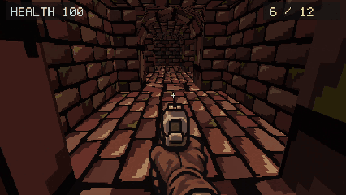

# SEWERLINE

  

### A retro horror FPS. An entire sewer beneath the streets. One 6.37 MB executable.

SEWERLINE is a compact first-person shooter built in **C++20 with SDL3 and OpenGL**, without a game engine. Navigate a procedurally generated sewer network, survive pursuing worms, and make every round count on the way to the exit.

The complete Windows build fits into a single executable—including textures, animated sprites, sound effects, SDL, and the C++ runtime. No installer, separate asset folder, or additional runtime setup.

## Survive the tunnels

**Find your way out.** Each run generates a connected maze with branching passages, loops, scattered supply shafts, and a distant exit. Die, restart the same seed, and use what you learned.

**Call for supplies.** Ammunition is tied to the world. Find a marked ceiling shaft, make a phone call, and wait for a box to drop into the sewer. Collect it to gain 12 reserve rounds. Each shaft can only be used once.

**Keep something in the chamber.** Start with six rounds loaded and twelve in reserve. Run completely dry and the pistol gives way to fists; collecting ammunition equips it again.

**Stay ahead of the worms.** Enemies follow the maze's passage network, negotiate corners, and close in as you move. A difficulty director adjusts pressure using elapsed time, health, and ammunition, activating dormant enemies outside direct sight.

## Built for a small footprint

| Windows x64 release | Size |
| --- | ---: |
| **Complete playable executable** | **6,365,696 bytes · 6.37 MB** |
| Executable plus license and credit documents | 6,368,916 bytes · 6.37 MB |

These are runnable file sizes, not archive sizes. MB denotes 1,000,000 bytes.

- **Static linking:** SDL and the C++ runtime are compiled into the executable.
- **A focused runtime:** unused SDL subsystems and its dynamic replacement API are disabled, allowing unused code to be discarded.
- **Size-oriented compilation:** whole-program optimization, function/data elimination, and identical-code folding.
- **Embedded resources:** textures and audio use lossless LZMS storage and decode directly into memory, without extracting files to disk.
- **Procedural geometry:** the sewer is built from generated passages rather than stored level meshes.

Textures and sound effects retain their original quality through lossless asset packing.

## Engineering

### Procedural level generation

A seeded randomized depth-first traversal creates the maze, with additional links introducing loops. Breadth-first distances support exit placement and navigation. Supply placement and connectivity checks keep the generated layout traversable.

### Enemy navigation and encounter pressure

A shared flow field gives pursuing enemies routes through the cell graph. Continuous movement adds wall sliding, local separation, and stuck recovery. Enemy state machines handle idle, chase, attack, and death states.

The director adjusts encounter pressure, speed, and attack timing as the run develops. Reinforcements activate from the existing population; enemies do not respawn indefinitely. Nearby enemies can also detect the player independently.

### A compact rendering pipeline

OpenGL renders polygonal sewer geometry into a **426×240 framebuffer**, then scales it with nearest-neighbor filtering. Octagonal tunnel entrances, distance fog, camera-facing enemy sprites, animated weapon overlays, and a bitmap font establish the retro presentation.

### Event-driven audio and in-memory assets

Embedded resources are decoded and cached in memory. WAV effects are converted for SDL audio playback and routed through separate streams for weapon actions, footsteps, creature/damage sounds, and calls.

## Play

Run `sewerline.exe` from a portable build. Requires **Windows x64** and an **OpenGL 3.3-capable graphics driver**. Gameplay runs offline.

| Input | Action |
| --- | --- |
| WASD / mouse | Move / look |
| Shift | Sprint |
| Left mouse | Fire, or punch when completely out of ammunition |
| Right mouse | Punch when completely out of ammunition |
| R | Reload |
| E | Request supplies / use the exit |
| Escape | Pause / resume |
| Enter after death | Restart the same maze |

## Project status

A playable Windows prototype featuring procedural exploration, combat, physical resupply, adaptive enemy pressure, and an exit with run statistics.

## License

Audio sources and licenses are listed in [assets/audio/LICENSES.md](assets/audio/LICENSES.md).

Project code is available under the [MIT license](LICENSE.txt). SDL retains its own license, included with portable builds.
